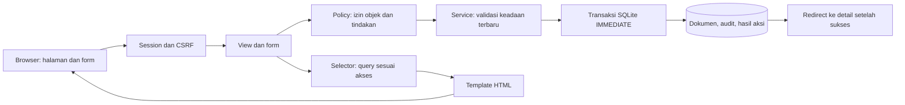

# Arsitektur Procurement

Versi 1.0 | 22 Oktober 2026

## Tujuan rancangan

Aplikasi mengelola permintaan sampai penerimaan barang atau jasa dalam satu organisasi. Pengguna bekerja melalui halaman per peran, sedangkan server memeriksa izin, revisi, jumlah, dan perubahan status. [PRD](PRD.md) menetapkan kebutuhan produk; [proses bisnis](BUSINESS_PROCESS.md) menetapkan transisinya. Penyimpanan dijelaskan pada [model data](DATA_MODEL.md), dan urutan pembangunan pada [rencana implementasi](IMPLEMENTATION_PLAN.md).

## Keputusan teknis

| Keputusan           | Pilihan                                                         | Alasan dan konsekuensi                                                                                                                                                                                      |
| ------------------- | --------------------------------------------------------------- | ----------------------------------------------------------------------------------------------------------------------------------------------------------------------------------------------------------- |
| Framework           | Django 5.2 LTS; baseline dependensi 5.2.18                      | Memakai autentikasi, form, ORM, migrasi, dan test runner bawaan. Patch diperiksa kembali saat instalasi, lalu dipatok tepat dalam requirements. Seri 5.2 masih mendapat extended support sampai April 2028. |
| Python              | Python 3.12, patch keamanan yang tersedia                       | Runtime lokal yang diperiksa: 3.12.14. Django 5.2 mendukung seri ini. Versi reviewer dan dependensi akan diperiksa saat setup.                                                                              |
| Penyajian halaman   | Django templates, CSS lokal, JavaScript seperlunya              | Satu proses aplikasi dan satu origin untuk halaman, session, dan form. Alur inti tetap berfungsi tanpa JavaScript.                                                                                          |
| Database awal       | SQLite pada file lokal `var/db.sqlite3`                         | Reviewer tidak memerlukan server database. Kapasitas penulisan bersamaan terbatas; target awal adalah demo lokal dengan transaksi singkat.                                                                  |
| Alternatif database | PostgreSQL untuk kebutuhan penulisan bersamaan yang lebih besar | Belum menjadi backend yang diimplementasikan atau dijamin kompatibel. Penambahan adapter, penguncian baris, migrasi data, dan suite concurrency perlu dikerjakan sebelum mengklaim dukungan.                |
| Nilai dan kuantitas | Integer berskala dalam database; `Decimal` di Python            | Menghindari perhitungan uang menggunakan float pada SQLite. Format input dan aturan pembulatan tetap mengikuti AS-07.                                                                                       |
| Pengujian           | Django test runner; `TransactionTestCase` untuk concurrency     | Menguji izin dan perubahan database melalui service serta HTTP. Browser melengkapi pengujian form, keyboard, dan layar kecil.                                                                               |

Django dengan frontend terpisah membutuhkan kontrak API, pengelolaan state, dan integrasi autentikasi tambahan. Flask membutuhkan perakitan komponen form, autentikasi, dan migrasi. Rancangan memilih Django templates agar pekerjaan berfokus pada alur pengadaan. Keputusan ini tidak membatasi rancangan visual halaman.

## Pembagian modul dan file

Struktur berikut adalah target implementasi. Konfigurasi Django, akun, template dasar, 14 model Procurement beserta migrasi, parser angka, serta helper token/replay sudah tersedia. Service akun dan permintaan, policy objek permintaan, serta halaman draft/detail/revisi sudah tersedia. Antrean dan keputusan approval serta pengembalian untuk revisi juga sudah tersedia. Vendor, penawaran dan pemilihan juga sudah tersedia. Penerbitan PO, daftar/detail dan halaman cetak juga tersedia. Penerimaan barang/jasa dan penutupan PO sudah tersedia. Tracking lintas tahap, pencarian/filter dan riwayat berhalaman sudah tersedia.

```text
manage.py
requirements.txt
requirements-dev.txt
.env.example
config/                    settings.py, urls.py, wsgi.py, asgi.py
common/                    actions.py, errors.py, forms.py, http.py, numbers.py, tests/
accounts/                  models.py, forms.py, policies.py, services.py, views.py, urls.py, tests/
procurement/
  models/                  requests.py, sourcing.py, orders.py, receipts.py, audit.py
  services/                requests.py, sourcing.py, orders.py, receipts.py
  forms/                   requests.py, sourcing.py, orders.py, receipts.py
  views/                   requests.py, sourcing.py, orders.py, receipts.py, tracking.py
  policies.py              izin per objek dan tindakan
  selectors.py             query daftar, detail, riwayat, dan jumlah
  inputs.py                dataclass input service
  urls.py
  management/commands/     seed_demo.py
  migrations/
  tests/
templates/                 base.html, registration/, accounts/, procurement/, errors/
static/                    css/app.css, js/forms.js
docs/
outputs/                   diagram BPMN dan workbook WBS
var/                       database lokal; diabaikan Git
tmp/                       bukti pemeriksaan lokal; diabaikan Git
```

Package `models`, `services`, `forms`, dan `views` mempunyai `__init__.py`. Django menemukan model melalui ekspor pada `procurement/models/__init__.py`. Gunakan tipe Python pada batas service dan input dataclass. Hindari repository atau dependency-injection framework tambahan: ORM sudah menjadi akses penyimpanan.

| Bagian           | Tanggung jawab                                                                                                                             |
| ---------------- | ------------------------------------------------------------------------------------------------------------------------------------------ |
| View             | Memilih form, memanggil policy/service, lalu merender atau mengarahkan pengguna.                                                           |
| Form             | Memvalidasi struktur input dan menampilkan kesalahan. Tidak menetapkan pemilik, status, total, atau peran dari input browser.              |
| Policy           | Memutuskan akses berdasarkan akun aktif, peran terkini, kepemilikan, dan objek. UI memakai keputusan yang sama untuk menampilkan tindakan. |
| Service          | Memvalidasi ulang aturan terhadap data terbaru, menjalankan transaksi, mengubah status, dan menulis audit.                                 |
| Model/constraint | Menjaga hubungan, keunikan, rentang angka, dan konsistensi dalam satu baris.                                                               |
| Selector         | Menyaring objek yang boleh dibaca, menghitung ringkasan, dan menyiapkan data tampilan. Tidak mengubah status.                              |

Semua perubahan dokumen bisnis melalui service. Jangan menyembunyikan alur transaksi dalam signal atau mengandalkan `model.save()` untuk validasi penuh. Perintah data demo juga memanggil service agar menghasilkan riwayat yang konsisten.

## Aliran request



Form memuat versi objek dan token aksi. Pengguna mengirim POST; service memeriksa ulang akun dan objek di dalam transaksi. Setelah commit, view mengirim redirect 303 ke detail. GET hanya membaca. Kesalahan validasi merender form yang terisi kembali tanpa menyimpan perubahan sebagian.

## Akun dan akses

Gunakan custom `accounts.User` sejak migrasi pertama, dengan satu field `role`: `REQUESTER`, `APPROVER`, `PROCUREMENT`, `RECEIVER`, atau `ADMIN`. Gunakan login username/password dan session Django. Tidak ada registrasi publik. Admin membuat akun, mengganti peran, menonaktifkan akun, dan mengatur password melalui form khusus.

Password memakai hasher dan validator Django. Setiap request memeriksa `is_active`. Sebelum mutasi, service membaca ulang peran akun dari database. `is_superuser` tidak memberikan pengecualian pada aturan bisnis. Route Django admin tidak diaktifkan pada versi pertama agar model transaksi tidak dapat diubah melalui jalur lain. Halaman `/users/` memakai service akun tersendiri. Admin aktif terakhir tidak dapat diturunkan perannya atau dinonaktifkan; guard dijalankan di dalam transaksi IMMEDIATE. Reset password membatalkan sesi lama melalui hash autentikasi Django, dan self-reset mengakhiri sesi yang sedang dipakai.

Daftar dan detail mengikuti matriks PRD. Pemohon membaca miliknya; penerima membaca request yang sudah mempunyai PO, termasuk PO terminal. Approver, procurement, dan admin membaca sesuai fungsi pada PRD. Admin hanya mengelola akun/vendor dan membaca transaksi. Riwayat pengguna lama tetap dilindungi FK setelah perubahan peran atau penonaktifan.

Objek yang tidak boleh dibaca mengembalikan 404. Tindakan yang tidak diizinkan pada objek yang boleh dibaca mengembalikan 403. Tidak ada endpoint yang hanya mengandalkan tombol tersembunyi. User ID, role, approver, vendor aktif, dan relasi item diperiksa server. Session memakai autentikasi Django; izin per objek diterapkan pada aplikasi.

## Transaksi, versi, dan pengiriman ulang

SQLite dikonfigurasi dengan `OPTIONS.transaction_mode = "IMMEDIATE"`, `OPTIONS.timeout = 5`, dan `ATOMIC_REQUESTS = False`. Setiap service mutasi membuka `transaction.atomic()` sebelum membaca data bisnis yang menjadi dasar keputusan. Form boleh memvalidasi format sebelumnya, tetapi service mengulang pemeriksaan status, izin, vendor, versi, dan sisa setelah transaksi dimulai.

Mode ini menserialkan transaksi penulisan pada SQLite. Service tidak melakukan I/O jaringan, render template, atau pekerjaan lambat di dalamnya. `select_for_update()` tidak menjadi dasar keselamatan karena SQLite mengabaikannya. Timeout hanya membatasi waktu tunggu; timeout tidak meningkatkan kapasitas database.

Protokol setiap aksi:

1. Form GET memperoleh token bertanda tangan berisi UUID nonce, ID aktor, jenis/ID target, dan nama aksi. Token berlaku 24 jam dan dikirim bersama `expected_version`. Token pembuatan draft mempunyai target `new-request` dan belum mempunyai versi.
2. POST memverifikasi tanda tangan, masa berlaku, dan kecocokan scope. Service membuka transaksi, membaca ulang akun serta objek, dan memeriksa akses.
3. Service mencari `ActionReceipt`. Token yang sudah berhasil dengan payload sama mengembalikan objek hasil lama tanpa efek kedua. Payload berbeda dengan token sama menghasilkan konflik 409. Periksa replay sebelum versi/status, tetapi sesudah izin baca dan peran terkini.
4. Untuk aksi baru, service membandingkan `expected_version`, memeriksa guard, lalu menyimpan perubahan, audit, dan `ActionReceipt` dalam transaksi yang sama. Semua perubahan pada aggregate request menaikkan `PurchaseRequest.version`; posting/penutupan PO menaikkan `PurchaseOrder.version`. Edit vendor/akun memakai versi objek masing-masing.
5. Rollback tidak menyisakan penanda sukses. Pengguna boleh mencoba kembali dengan token dan payload yang sama. Form invalid mempertahankan nonce; token kedaluwarsa meminta pengguna memuat ulang tanpa menjalankan aksi.

Payload hash memakai SHA-256 dari JSON kanonik: field yang diizinkan, urutan baris stabil, angka dalam format desimal baku, termasuk versi awal, tanpa CSRF/password. Token dan hash tidak masuk log. Halaman pengelolaan akun menandai password, token aksi, CSRF, serta variabel lokal form sebagai sensitif untuk laporan exception pada mode non-debug. `ActionReceipt` menyimpan nonce dan hasil, tanpa token bertanda tangan atau password. Pembuatan akun dengan password dan reset password hanya boleh memakai nonce sekali; replay keduanya menghasilkan 409, bukan membandingkan atau menyimpan hash payload password. Ketentuan ini dijelaskan pada model data.

Unique constraint satu PO per request dan satu keputusan per revisi melengkapi pemeriksaan service. Token berbeda pada versi lama tetap ditolak. Penerimaan memakai token berbeda pada versi terbaru merupakan kejadian baru yang disengaja, tetap dibatasi jumlah sisa. Audit gagal harus menggagalkan transaksi bisnis.

## Peta halaman dan tindakan

Semua path di tabel adalah kontrak route yang akan dibuat. ID objek berbentuk UUID. POST action mempunyai route terpisah dan menerima token serta versi; GET tidak melakukan mutasi.

| Halaman / route                                     | Pembaca dan tugas utama                                         | Tindakan POST                                                                         |
| --------------------------------------------------- | --------------------------------------------------------------- | ------------------------------------------------------------------------------------- |
| `/login/`, `/logout/`                               | Seluruh akun; memulai/mengakhiri sesi                           | Login; logout hanya POST                                                              |
| `/`                                                 | Akun aktif; melihat pekerjaan yang perlu ditindaklanjuti        | Tautan menuju antrean sesuai peran                                                    |
| `/requests/`                                        | Sesuai policy; mencari nomor/judul dan memfilter jenis/tahap    | Tidak ada                                                                             |
| `/requests/new/`                                    | Pemohon; menyusun kebutuhan dan item                            | Simpan draft                                                                          |
| `/requests/<id>/`                                   | Sesuai policy; meninjau revisi, approval, PO, sisa, dan riwayat | `submit/`, `cancel/`, `review/`, `request-revision/`, `issue-po/` sesuai peran/status |
| `/requests/<id>/edit/`                              | Pemohon pemilik saat draft/revisi                               | Simpan working copy                                                                   |
| `/requests/<id>/revisions/<number>/`                | Sama dengan akses request; membaca snapshot historis            | Tidak ada                                                                             |
| `/approvals/`                                       | Approver; meninjau SUBMITTED selain milik sendiri               | Keputusan melalui detail request                                                      |
| `/vendors/`, `/vendors/new/`, `/vendors/<id>/edit/` | Procurement/admin; mengelola nama, kontak, dan keaktifan        | Simpan atau nonaktifkan; tidak ada hapus                                              |
| `/requests/<id>/quotations/`                        | Pengguna yang boleh membaca request; membandingkan penawaran    | `new/`, `<quote_id>/edit/`, `<quote_id>/select/` hanya procurement dengan guard       |
| `/orders/`, `/orders/<id>/`                         | Sesuai policy parent request; meninjau PO dan pemenuhan         | `close/` oleh approver bukan pemohon; hasil ditentukan accepted                       |
| `/orders/<id>/print/`                               | Sama dengan akses PO; mencetak snapshot PO melalui browser      | Tidak ada pengiriman ke vendor otomatis                                               |
| `/orders/<id>/receipts/new/`                        | Penerima; mengonfirmasi accepted/rejected dan bukti             | Posting penerimaan barang atau jasa                                                   |
| `/receipts/<id>/`                                   | Sama dengan akses parent request; membaca bukti penerimaan      | Tidak ada edit/hapus                                                                  |
| `/users/`, `/users/new/`, `/users/<id>/edit/`       | Admin; mengelola akun/peran/keaktifan                           | Simpan perubahan; reset password terpisah pada `<id>/password/`                       |

Menu awal: Permintaan untuk semua peran; Persetujuan untuk approver; Vendor untuk procurement/admin; Pesanan untuk pembaca sesuai policy; Akun untuk admin. Beranda menampilkan antrean yang dapat diakses, tanpa statistik sintetis. Tidak ada menu integrasi atau fitur yang belum tersedia.

Detail menampilkan dua status dengan label jelas: persetujuan permintaan dan pemenuhan PO. Selector menurunkan tahap operasional dari PO bila sudah ada. Riwayat dan revisi lama tetap dapat dibaca setelah penolakan/pembatalan. Form penerimaan menampilkan dipesan, diterima sebelumnya, ditolak sebelumnya, dan sisa per item, serta konsekuensi bahwa catatan final belum dapat dikoreksi.

Peta ini menetapkan informasi dan tindakan. Arah visual ditinjau sebelum styling antarmuka transaksi. Layout harus mendahulukan antrean, rincian item, perbandingan, sisa, dan keputusan. Periksa kosong, submit berlangsung, error, konflik, sukses, keyboard, dan lebar 390/768/1440. Alur HTML biasa tidak membutuhkan skeleton untuk navigasi penuh; kontrol submit memberi feedback dan tetap mempunyai fallback tanpa JavaScript.

## Kesalahan, konfigurasi, dan operasi

| Kondisi                                                      | Respons                                                             |
| ------------------------------------------------------------ | ------------------------------------------------------------------- |
| Format/aturan field tidak valid                              | HTTP 400, pesan pada field/ringkasan, input aman dipertahankan      |
| Belum login                                                  | Redirect ke login dengan tujuan lokal yang tervalidasi              |
| Akses terlarang / CSRF gagal                                 | HTTP 403; tidak mengubah data                                       |
| Objek tidak tersedia bagi pengguna                           | HTTP 404 tanpa membocorkan pemilik                                  |
| Versi lama, token dipakai untuk payload lain, status berubah | HTTP 409, ringkasan konflik dan tautan muat ulang                   |
| SQLite busy/locked setelah timeout                           | HTTP 503 dan `Retry-After: 1`; tidak mencoba mutasi ulang diam-diam |
| Kegagalan tak terduga                                        | HTTP 500 dengan pesan aman dan ID korelasi; rollback                |

Tangkap exception database setelah keluar dari blok `atomic`, lalu petakan hanya konflik yang dikenal. Jangan menyamarkan error pemrograman menjadi pesan validasi. Log memakai ID korelasi, jenis error, ID aktor/objek, dan action; tidak menyimpan isi password, cookie, token, atau payload bebas.

Gunakan `USE_TZ=True`, `TIME_ZONE="Asia/Jakarta"`, dan bahasa antarmuka Indonesia. Simpan timestamp UTC, tampilkan WIB. GET login memvalidasi parameter `next` agar tidak membuka redirect eksternal. Gunakan CSRF, escaping template, password validator, cookie HttpOnly/SameSite, dan pengaturan Secure cookie pada HTTPS. Form yang mengubah data menggunakan proteksi CSRF Django.

Konfigurasi membaca environment melalui standard library. `SECRET_KEY` wajib dari environment dan tidak mempunyai fallback rahasia di kode. `.env.example` hanya mendokumentasikan nama variabel; file `.env` tidak dimuat otomatis tanpa mekanisme yang dinyatakan. Local development menggunakan DEBUG eksplisit dan host loopback. Mode non-debug mewajibkan secret/host yang sesuai; deployment dan layanan hosting belum dipilih.

Database test ditetapkan pada `var/test.sqlite3` melalui `DATABASES["default"]["TEST"]["NAME"]`, terpisah dari database kerja. Folder var dibuat saat setup. Suite concurrency menggunakan file ini dan koneksi terpisah; jangan menjalankan suite pada database kerja atau memakai path test yang sama dengan database kerja.

`requirements.txt` mematok dependensi runtime hasil instalasi terverifikasi, termasuk dependensi transitif; `requirements-dev.txt` mengacu runtime dan tool pemeriksaan yang benar-benar digunakan. SQLite, virtualenv, cache, `.env`, dan bukti browser diabaikan Git. README akhir harus membuktikan setup bersih, migrasi, seed demo, startup, dan pengujian. Data demo berlabel sintetis dan memakai password demo yang diatur pengguna melalui environment.

Daftar memakai paginasi 25 baris dan query dalam scope akses. Gunakan `select_related`/`prefetch_related` untuk relasi yang ditampilkan. Hitung uang di Python, bukan perkalian float atau SQL SQLite. Tidak ada target latency atau klaim kapasitas sebelum pengukuran.

## Batas dan keputusan sebelum coding

Django dan SQLite menjadi stack implementasi. Akun, permintaan, approval, sourcing, PO, penerimaan, penutupan, tracking dan audit sudah tersedia. Antarmuka bersama memakai aset lokal serta antrean yang dibatasi menurut peran. Instalasi bersih dan data demo mengikuti Tugas 11. Fitur AI, stok, pembayaran, unggah berkas, frontend terpisah, serta dukungan PostgreSQL berada di luar versi awal. Bukti runtime dan keterbatasan pemeriksaan dicatat pada TESTING.

## Jalur permintaan yang tersedia

GET daftar/detail/revisi memakai `visible_requests`: pemohon melihat miliknya, approver/procurement/admin melihat permintaan sesuai fungsi, dan penerima melihat permintaan yang sudah memiliki PO. Objek di luar scope menghasilkan 404. Mutasi draft/submit/cancel memeriksa kembali pemilik dengan peran REQUESTER yang masih aktif di dalam transaksi. Review memerlukan APPROVER selain pemilik; pengembalian ke revisi memerlukan PROCUREMENT.

POST draft melewati form dan formset, kemudian input dataclass kanonik ke `save_draft`. Tombol Tambah baris item merender ulang form tanpa menyimpan data dan tidak membutuhkan JavaScript. Baris kosong diabaikan; baris parsial ditolak. Total dihitung server. Submit dan cancel memakai service terpisah dengan token, versi, audit dan receipt atomik. Snapshot hanya dapat dibaca melalui halaman revisi. Form aksi bersama berada pada `common/forms.py`; pemetaan validasi dan SQLite busy/locked berada pada `common/http.py`.

Regresi service/HTTP serta dua koneksi SQLite sudah memeriksa replay dan pengajuan serentak. Bukti beserta batas pemeriksaan berada pada TESTING; ini belum pembuktian seluruh alur pengadaan.

## Review dan pengembalian untuk revisi

GET `/approvals/` hanya untuk APPROVER, menampilkan request SUBMITTED selain milik sendiri dengan paginasi 25 baris. Halaman detail menautkan snapshot aktif dan plafonnya sebelum form keputusan. POST review memeriksa ulang akun, role dan larangan self-review sebelum replay; versi, status, snapshot aktif dan keputusan tunggal diperiksa sebelum mutasi.

`review_request` menyimpan ApprovalDecision untuk revisi aktif, menaikkan versi request dan mengubah status sesuai keputusan. REQUEST_CHANGES dan REJECT memerlukan alasan; APPROVE boleh tanpa catatan. `request_revision` hanya menerima PROCUREMENT pada APPROVED, dengan persetujuan revisi aktif dan tanpa PO sepanjang riwayat. Aksi ini mengosongkan kandidat/alasan pemilihan dan menulis audit tanpa mengganti keputusan approver sebelumnya. Snapshot dan penawaran historis tetap tersimpan. Semua hasil ditulis bersama audit dan ActionReceipt dalam satu transaksi IMMEDIATE.

## Sourcing yang tersedia

Procurement/admin mengelola vendor melalui service `save_vendor`; tidak ada endpoint hapus. Nama, kontak, status dan versi diperiksa server. Vendor nonaktif tetap dapat dibaca pada dokumen historis. Daftar vendor dipaginasi 25 baris.

`save_quotation` memakai versi request. Header penawaran dan harga dinormalisasi sebelum hashing; service mencocokkan tepat seluruh ID RevisionItem aktif, lalu mengambil jumlah/satuan dari snapshot dan menghitung total dengan integer. Revisi harus APPROVED dengan keputusan APPROVE, dan request belum pernah memiliki PO. Penawaran masa depan, kedaluwarsa atau di atas plafon dapat disimpan untuk perbandingan; kelayakan dipisahkan dari pencatatan.

`procurement/quotations.py` memeriksa tanggal WIB, vendor aktif, kesesuaian rincian/total dan plafon. `select_quotation` mengulang pemeriksaan dalam transaksi, menghitung vendor unik yang layak dan mewajibkan alasan sumber tunggal bila hanya satu. Pilihan tidak otomatis mengikuti harga terendah. Edit penawaran terpilih membersihkan pointer serta kedua alasan; audit mempertahankan alasan sebelumnya.

Halaman perbandingan mengikuti scope pembaca request dan memisahkan revisi aktif dari riwayat. Hanya procurement mempunyai kontrol mutasi. Token quote create/edit/select berada pada scope REQUEST; digest edit juga memuat ID quotation. Replay berhasil dapat dikembalikan setelah vendor dinonaktifkan, sementara aksi baru tetap ditolak. Error, CSRF, redaksi token dan variabel lokal mengikuti pola akun/permintaan.

## Penerbitan dan pembacaan PO

`issue_order` membaca aktor aktif dengan peran PROCUREMENT dan parent dalam scope sebelum replay. Versi yang dikirim adalah versi request. Untuk aksi baru, service memeriksa ulang persetujuan revisi aktif, kandidat, vendor, tanggal WIB, rincian/total, plafon dan jumlah sumber vendor yang layak. Jika alternatif berubah menjadi satu sumber tanpa alasan yang sesuai, pengguna perlu memilih kembali penawaran. Keberadaan PO, termasuk terminal, menolak penerbitan kedua.

Header dan item PO, kenaikan versi request, AuditEvent serta ActionReceipt ditulis bersama pada transaksi IMMEDIATE. Request tetap APPROVED; PO dimulai ISSUED/version 1. Harga, jumlah, unit, nama/kontak vendor, tujuan dan alasan berasal dari data yang divalidasi server. Caller tidak memasok total, status, vendor, item atau issuer pada endpoint penerbitan.

`visible_orders` mengikuti scope parent request. Daftar memakai paginasi 25 baris. Detail dan cetak memakai salinan field PO/item; nama penerbit historis diambil dari audit penerbitan agar perubahan username tidak mengganti identitas pada tampilan dokumen. Status PO tetap merupakan keadaan terkini. Halaman cetak berupa GET dengan stylesheet cetak A4; tidak menyimpan file, memanggil printer, atau mengirim pesan ke vendor. Render PDF A4 satu PO diperiksa melalui browser lokal; dialog printer, cetak fisik dan dokumen beberapa halaman belum diperiksa.

## Tracking dan penyajian riwayat

Selector membatasi akses sebelum pencarian, filter tahap/jenis dan paginasi. Tahap operasional memakai status PO jika sudah ada, atau status permintaan jika belum ada PO. CLOSED_SHORT ditampilkan sebagai Selesai dengan kekurangan; status permintaan asal dan sisa setiap item tetap tersedia.

`order_balances` pada selectors menjadi pemilik perhitungan ordered_milli, accepted_milli, rejected_milli dan remaining_milli per UUID item. Service penerimaan/penutupan dan modul presentasi memakai hasil yang sama. Akumulasi memakai integer Python agar riwayat penolakan tidak melampaui batas SQL SUM SQLite. Modul presentation memformat hasil; stages menyimpan label tahap serta tindakan; template tidak menghitung aturan bisnis.

Halaman daftar memakai views/tracking dan form filter bersama. Pencarian dibatasi 200 karakter, tahap/jenis divalidasi, dan filter invalid menghasilkan 400 dengan daftar kosong. Halaman yang tidak valid memakai pemulihan Paginator.get_page. Daftar dan audit dibagi 25 per halaman dengan urutan stabil. Audit disajikan dari yang paling awal, dengan snapshot nama/peran, waktu WIB, dan alasan yang di-escape.

## Antarmuka dan pemulihan

`procurement/dashboard.py` menyusun antrean delapan dokumen terawal dalam scope pengguna. Pemohon melihat draft/perlu revisi, approver melihat pengajuan selain miliknya, procurement melihat permintaan disetujui yang belum memiliki PO, dan penerima melihat pesanan yang masih terbuka. Admin memakai tautan pengelolaan akun/vendor. Antrean tidak menjadi sumber izin mutasi; service tetap memeriksa aktor dan dokumen saat POST.

Kerangka template memuat CSS, font dan JavaScript lokal. Menu memakai elemen details native; JavaScript menyesuaikan keadaan desktop/mobile serta mengembalikan focus ketika Escape ditekan. Validasi dirender sekali di dalam form yang bermasalah, melalui pesan umum atau pesan per field, tanpa ringkasan global maupun pemindahan focus otomatis. Hubungan aria-invalid/aria-describedby tetap berasal dari form Django. Tautan muat ulang untuk pemulihan konflik berada di dalam form. Handler 400/403/404/500 dan kegagalan CSRF memakai pesan aman serta jalur kembali. Konflik 409 dan database sibuk 503 tetap mengikuti helper HTTP yang ada. Keadaan dokumen yang tidak lagi menyediakan form dapat memakai satu pemberitahuan kontekstual tanpa membuat form semu.

Pemformatan frontend memakai Prettier lokal dengan plugin yang mempertahankan token Django, dikonfigurasi dalam .prettierrc.json. Versi tool dipatok pada package.json dan package-lock.json. Tool ini tidak terlibat dalam startup atau runtime Django. Hindari parser HTML generik tanpa plugin karena pemenggalan tag dapat membuat template gagal dikompilasi atau menampilkan ekspresi variabel sebagai teks.

Peningkatan form menandai submit berlangsung dan menahan pengiriman berikutnya pada halaman yang sama, tanpa menonaktifkan submitter yang membawa intent. Peristiwa pageshow memulihkan keadaan setelah browser Back. Token, versi dan transaksi server tetap menjadi penjaga replay ketika JavaScript mati. Perbandingan membangun rincian setelah paginasi; detail PO dan form penerimaan memuat item secara prefetch. Snapshot revisi diprefetch sekali pada perbandingan dan pemilihan kandidat; penerbitan PO juga memakai snapshot yang diprefetch. Kedua paginator penawaran mempertahankan parameter satu sama lain. Tautan tindakan pada detail mobile memindahkan focus native ke panel tindakan yang dapat difokuskan.

## Bantuan AI Opsional

Endpoint POST `/requests/assist/` hanya melayani Pemohon aktif dengan CSRF. Modul `procurement/ai` memisahkan konfigurasi privat, normalisasi gambar, kontrak JSON, kuota dan client Groq. Hasil hanya menjadi usulan pada browser; simpan/ajukan draf tetap melalui form dan service yang ada. Tidak ada tool execution atau akses model ke database bisnis.

Kuota atomik memakai SQLite terpisah di DATA_DIR/ai, dengan hitungan metadata saja. Transaksi kuota selesai sebelum panggilan jaringan; lock database bisnis tidak ditahan. HTTPX async dibungkus deadline total20detik di view sinkron, tanpa retry/redirect; kegagalan dipetakan ke JSON aman. Konfigurasi ai.json independen dari secret hosting. Pillow memvalidasi serta re-encode JPG/PNG. Ketentuan dan batas ada pada [AI_INPUT](AI_INPUT.md).

## Setup Demo

Command `seed_demo` memvalidasi password dari environment sebelum mutasi. Satu transaksi membentuk akun, vendor dan lima skenario lewat service bisnis yang sama dengan UI. Bootstrap admin memakai pembuatan akun normal dengan validator; akun lainnya melalui service admin. Model `DemoSetup` mencatat identitas hasil seed, sehingga pemanggilan berikutnya hanya melaporkan data yang sudah dimiliki. Benturan, identitas yang hilang dan perubahan username ditolak tanpa mengambil alih data. Password, peran serta kemajuan transaksi tidak dipulihkan otomatis. Database demo dipilih melalui `DJANGO_DATA_DIR`; data kerja tidak digunakan untuk pengujian.
