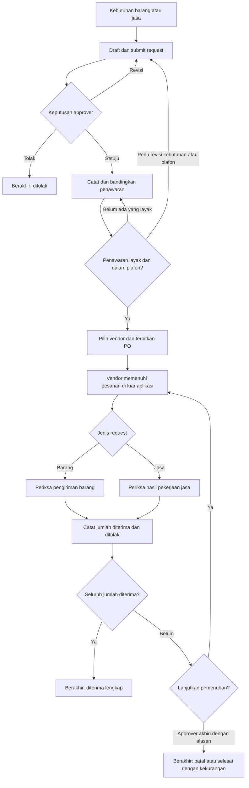

# Rancangan proses bisnis Procurement

Versi: 1.1, 25 Oktober 2026.
Revisi: keterangan bantuan AI opsional; ID tugas/gateway dan transisi bisnis tetap.
Status: baseline proses pengadaan. Diagram swimlane dan berkas yang dapat diedit tersedia pada outputs/.
Pemilik kebutuhan, aturan, scope, dan acceptance criteria: [PRD.md](PRD.md).
Dokumen ini menetapkan aktivitas, gateway, dan perubahan status pengadaan sebagai dasar diagram BPMN dan paket pekerjaan WBS.

## 1. Peserta dan batas proses

Pool utama: Organisasi. Lane bisnis: Pemohon, Approver, Procurement, dan Penerima Barang/Jasa. Lane Sistem dapat digunakan untuk validasi, nomor dokumen, audit, dan perhitungan otomatis. Admin adalah proses pendukung untuk akun/master data, sehingga tidak perlu menjadi lane dalam alur pengadaan utama.

Pool eksternal: Vendor, tanpa login aplikasi. Penawaran, penyampaian PO, pengiriman, dan pelaksanaan jasa melibatkan komunikasi manual di luar aplikasi. Procurement mencatat fakta/referensinya; aplikasi tidak mengklaim mengirim atau menerima pesan eksternal secara otomatis.

Start: kebutuhan barang/jasa diidentifikasi. End normal: semua jumlah item diterima sesuai pesanan. End pengecualian dibedakan: request ditolak, request dibatalkan, PO dibatalkan, atau PO diakhiri dengan sisa belum dipenuhi.

## 2. Ringkasan alur

Diagram ini adalah ringkasan flowchart untuk membaca proses, bukan pengganti swimlane BPMN. Cabang pembatalan sebelum PO, gateway validasi, serta message flow ke vendor dijabarkan di bawah dan harus dimasukkan pada BPMN final.

## 3. Katalog tugas untuk BPMN

| ID    | Lane/peserta            | Tugas                                                                      | Input dan keluaran                                                                    |
| ----- | ----------------------- | -------------------------------------------------------------------------- | ------------------------------------------------------------------------------------- |
| BP-00 | Admin/Sistem, pendukung | Siapkan akun/peran dan autentikasi pengguna.                               | Akun aktif; sesi dan akses sesuai peran.                                              |
| BP-01 | Pemohon                 | Buat atau revisi request dan item.                                         | Kebutuhan barang/jasa; draft/revisi siap diajukan.                                    |
| BP-02 | Pemohon/Sistem          | Submit, validasi kelengkapan, hitung total, dan kunci revisi untuk review. | Request valid; status SUBMITTED dan nomor/revisi tercatat.                            |
| BP-03 | Approver                | Review kebutuhan dan plafon, lalu putuskan.                                | Request diajukan; setuju/revisi/tolak melalui GW-01.                                  |
| BP-04 | Procurement             | Siapkan vendor aktif untuk dimintai penawaran.                             | Identitas/kontak vendor; master vendor tersedia.                                      |
| BP-05 | Procurement/Vendor      | Minta penawaran secara manual, terima respons, lalu catat penawaran.       | Request revisi disetujui; penawaran lengkap dan bisa dibandingkan.                    |
| BP-06 | Procurement             | Bandingkan dan pilih penawaran dengan alasan.                              | Harga, masa berlaku, waktu pemenuhan, dan kesesuaian; kandidat terpilih.              |
| BP-07 | Procurement/Pemohon     | Kembalikan kebutuhan/plafon untuk revisi bila diperlukan sebelum PO.       | Alasan; CHANGES_REQUESTED, lalu kembali BP-01.                                        |
| BP-08 | Procurement/Sistem      | Terbitkan PO secara atomik dari penawaran terpilih.                        | Revisi, vendor dan plafon valid; satu PO immutable dengan snapshot.                   |
| BP-09 | Procurement/Vendor      | Tampilkan/cetak PO dan sampaikan manual ke vendor.                         | PO terbit; salinan/nomor untuk pemenuhan. Tidak ada klaim pengiriman otomatis.        |
| BP-10 | Vendor                  | Kirim barang atau laksanakan jasa.                                         | PO; pengiriman atau hasil pekerjaan di luar aplikasi.                                 |
| BP-11 | Penerima                | Periksa barang, kuantitas dan kesesuaiannya.                               | Barang dan referensi pengiriman; hasil accepted/rejected.                             |
| BP-12 | Penerima                | Periksa hasil jasa terhadap item/periode yang dipesan.                     | Hasil pekerjaan dan referensi; hasil accepted/rejected serta catatan penerimaan jasa. |
| BP-13 | Penerima/Sistem         | Posting hasil penerimaan dan hitung ulang sisa item.                       | Data valid; riwayat penerimaan, total accepted/rejected dan status PO.                |
| BP-14 | Pemohon                 | Batalkan request sebelum memiliki PO.                                      | Status yang diizinkan dan alasan; request CANCELLED.                                  |
| BP-15 | Approver                | Batalkan PO tanpa accepted atau akhiri sisa PO setelah sebagian diterima.  | PO terbuka, alasan, accepted historis; hasil terminal sesuai GW-06.                   |
| BP-16 | Semua internal/Sistem   | Pantau detail, antrean, sisa dan audit sesuai akses.                       | Data yang diizinkan; informasi keadaan saat ini dan tindakan berikutnya.              |

Langkah gabungan beberapa lane pada tabel ini harus dipecah menjadi user task, service task, atau message flow yang tepat saat menggambar BPMN. Nomor BP tetap menjadi referensi induknya.

### Bantuan AI opsional pada BP-01 (OPT-01)

- Saat membuat draf baru, pemohon dapat mengisi manual atau memakai bantuan AI dari teks/gambar.
- AI memberi usulan. Pemohon memeriksa hasilnya, lalu memilih **Terapkan ke Form**.
- Penerapan mengisi kolom kosong dan menambahkan item tanpa menimpa isian pengguna.
- Pemohon tetap melengkapi form, memilih **Simpan Draf**, lalu mengajukan permintaan secara terpisah.
- AI tidak menyimpan atau mengajukan draf, menyetujui permintaan, maupun menerbitkan PO. Jika bantuan gagal, input manual tetap tersedia.

Rincian langkah tersedia pada [panduan pengguna](USER_GUIDE.md#bantu-isi-dengan-ai-opsional). Bantuan ini tidak menambah transisi status, tugas wajib, atau gateway baru pada BPMN.

## 4. Gateway dan cabang

| ID    | Pertanyaan                                               | Jalur dan tujuan                                                                                                                   |
| ----- | -------------------------------------------------------- | ---------------------------------------------------------------------------------------------------------------------------------- |
| GW-01 | Apa hasil review?                                        | Setuju ke BP-04; minta revisi ke BP-01; tolak ke end ditolak. Pilihan saling eksklusif.                                            |
| GW-02 | Ada penawaran yang lengkap dan layak?                    | Ya ke BP-06; tidak tetap menunggu/mencari penawaran di BP-05, atau batal melalui BP-14. Tidak ada penawaran fiktif otomatis.       |
| GW-03 | Penawaran terpilih memenuhi plafon dan validitas?        | Ya ke BP-08; belum layak kembali BP-05/06; perlu mengubah kebutuhan/plafon ke BP-07 lalu review ulang BP-03 setelah submit.        |
| GW-04 | Barang atau jasa?                                        | Barang ke BP-11; jasa ke BP-12. Jenis tidak bercampur dalam satu request.                                                          |
| GW-05 | Semua jumlah item diterima sesuai?                       | Ya ke end diterima lengkap; belum kembali menunggu BP-10 atau ke BP-15 bila pemenuhan dihentikan.                                  |
| GW-06 | Berapa accepted kumulatif saat approver menghentikan PO? | Nol menjadi CANCELLED; lebih dari nol tetapi belum lengkap menjadi CLOSED_SHORT. PO yang sudah lengkap tidak dapat diakhiri ulang. |

Pembatalan sebelum PO tersedia sebagai cabang pengecualian dari draft, revisi, review, atau sourcing, dengan guard FR-10. Pembatalan PO dapat terjadi saat menunggu pengiriman, sebelum penerimaan pertama, atau setelah catatan penolakan; tidak harus melewati penerimaan baik dahulu.

Tidak perlu gateway untuk setiap validasi form. Validasi yang gagal mengembalikan error pada tugas yang sama dan tidak memajukan status.

## 5. Status request dan transisinya

Status request merepresentasikan persetujuan kebutuhan, bukan seluruh pemenuhan. Status PO dan penerimaan ditampilkan terpisah untuk mencegah dua sumber status pemenuhan yang saling bertentangan.

| Dari                                       | Aksi                    | Aktor                  | Ke                | Guard dan efek                                                                       |
| ------------------------------------------ | ----------------------- | ---------------------- | ----------------- | ------------------------------------------------------------------------------------ |
| Belum ada                                  | Simpan draft            | Pemohon                | DRAFT             | Kepemilikan ditetapkan server.                                                       |
| DRAFT                                      | Edit/simpan             | Pemohon pemilik        | DRAFT             | Item/estimasi boleh berubah; belum ada persetujuan.                                  |
| DRAFT                                      | Submit                  | Pemohon pemilik        | SUBMITTED         | Validasi lengkap, revisi 1, total dibekukan untuk review.                            |
| SUBMITTED                                  | Minta revisi            | Approver bukan pemilik | CHANGES_REQUESTED | Alasan wajib; satu keputusan per aksi/versi.                                         |
| SUBMITTED                                  | Tolak                   | Approver bukan pemilik | REJECTED          | Alasan wajib; terminal, tidak bisa submit ulang.                                     |
| SUBMITTED                                  | Setuju                  | Approver bukan pemilik | APPROVED          | Revisi dan plafon disahkan; audit keputusan.                                         |
| APPROVED                                   | Kembalikan untuk revisi | Procurement            | CHANGES_REQUESTED | Belum ada PO; alasan wajib; persetujuan dan penawaran lama tidak lagi layak dipakai. |
| CHANGES_REQUESTED                          | Edit/simpan             | Pemohon pemilik        | CHANGES_REQUESTED | Isi editable; belum memiliki persetujuan yang aktif.                                 |
| CHANGES_REQUESTED                          | Submit ulang            | Pemohon pemilik        | SUBMITTED         | Validasi ulang, revisi bertambah satu; penawaran revisi lama tetap historis.         |
| DRAFT/CHANGES_REQUESTED/SUBMITTED/APPROVED | Batalkan request        | Pemohon pemilik        | CANCELLED         | Belum ada PO, alasan wajib; invalidate kelayakan penawaran.                          |

Semua transisi lain ditolak. Tidak ada edit kebutuhan/qty setelah APPROVED tanpa kembali ke revisi, dan tidak ada revisi setelah PO diterbitkan. Request REJECTED/CANCELLED terminal; pengguna membuat request baru jika kebutuhan muncul lagi.

Persetujuan lama tetap tersimpan sebagai sejarah; hanya keputusan untuk revisi aktif yang menjadi dasar penerbitan PO. Procurement tidak dapat mengembalikan request APPROVED ke revisi setelah PO ada.

Setiap revisi yang diajukan menyimpan snapshot kebutuhan/item saat submit. Pemohon mengedit working copy ketika diminta revisi; snapshot lama dan hubungan penawaran terhadap revisi lama tetap utuh. Status terkini tidak menggantikan bukti isi revisi historis.

## 6. Penawaran dan PO

Penawaran berhubungan dengan revisi request. Penawaran hanya editable selama request APPROVED, belum ada PO, dan penawaran masih pada revisi aktif. Pemilihan ulang mengubah kandidat terpilih; penerbitan PO tetap aksi terpisah. Satu penawaran terpilih aktif per request, dengan vendor dan harga yang dapat diverifikasi pengguna.

| Dari                      | Aksi               | Aktor                          | Ke                 | Guard dan efek                                                                                                                                              |
| ------------------------- | ------------------ | ------------------------------ | ------------------ | ----------------------------------------------------------------------------------------------------------------------------------------------------------- |
| Belum ada                 | Terbitkan PO       | Procurement                    | ISSUED             | APPROVED, revisi aktif, penawaran terpilih valid, vendor aktif, seluruh item cocok, total <= plafon, belum pernah ada PO. Snapshot dan nomor dibuat sekali. |
| ISSUED                    | Posting penerimaan | Penerima                       | ISSUED             | Ada penolakan tetapi accepted masih nol; tetap terbuka.                                                                                                     |
| ISSUED/PARTIALLY_RECEIVED | Posting penerimaan | Penerima                       | PARTIALLY_RECEIVED | Accepted kumulatif positif dan setidaknya satu item belum penuh.                                                                                            |
| ISSUED/PARTIALLY_RECEIVED | Posting penerimaan | Penerima                       | RECEIVED           | Accepted semua item tepat sama dengan qty pesanan; terminal normal.                                                                                         |
| ISSUED                    | Batalkan PO        | Approver bukan pemilik request | CANCELLED          | Accepted seluruh item nol; alasan wajib; catatan penolakan sebelumnya tetap historis.                                                                       |
| PARTIALLY_RECEIVED        | Akhiri sisa        | Approver bukan pemilik request | CLOSED_SHORT       | Sebagian diterima; alasan wajib, sisa historis tidak dipaksa menjadi nol.                                                                                   |

PO RECEIVED/CANCELLED/CLOSED_SHORT menolak edit dan penerimaan baru. Tidak ada penggantian vendor atau PO kedua untuk request yang sama. Kebutuhan sisa sesudah terminal harus memakai request baru dan merujuk nomor lama dalam alasan.

Pada request yang sudah memiliki PO, status persetujuan tetap APPROVED sebagai fakta historis. Tahap tracking berasal dari PO: ISSUED = dipesan; PARTIALLY_RECEIVED = diterima sebagian; RECEIVED = selesai; CLOSED_SHORT = selesai dengan kekurangan; CANCELLED = PO dibatalkan. Jangan menampilkan APPROVED sendirian sebagai tahap operasional.

## 7. Perhitungan dan penerimaan

- Untuk tiap item: remaining = ordered_qty - jumlah accepted dari seluruh penerimaan yang berhasil diposting.
- Rejected dicatat terpisah; tidak dikurangi dari remaining. Barang pengganti dapat diterima selama accepted tambahan tidak melebihi remaining.
- Accepted/rejected keduanya >= 0; minimal satu rincian memiliki accepted atau rejected > 0. Rincian dengan dua nilai nol tidak menambah kejadian penerimaan.
- Total yang datang/diperiksa pada catatan = accepted + rejected. Jika vendor membawa kelebihan, accepted tetap dibatasi remaining dan kelebihannya dicatat rejected dengan alasan. Tidak ada stok tambahan.
- Satu penerimaan hanya untuk satu PO dan item PO tersebut; item request lain tidak dapat disisipkan.
- Bukti layanan memuat periode pelaksanaan, referensi penyelesaian dan catatan hasil. Kuantitas jasa menggunakan unit yang disetujui, misalnya sesi atau paket; bukan persen yang diciptakan di luar pesanan.
- Posting beberapa item merupakan satu transaksi. Jika satu item invalid, tidak ada rincian atau status yang tersimpan sebagian.
- Kunci deduplikasi dan pemeriksaan revisi/versi ditetapkan pada rancangan teknis. Tombol disabled saja tidak cukup untuk menghindari dua penerimaan dari satu submit.
- Kesalahan input sebelum posting dapat diperbaiki. Setelah posting, catatan tidak dapat ditimpa/dihapus; keterbatasan koreksi harus dijelaskan sebelum pengguna melakukan konfirmasi.

Contoh sintetis untuk pengujian: pesan 10 unit; penerimaan pertama accepted 6/rejected 2 menghasilkan remaining 4, bukan 2. Kiriman berikutnya accepted 4 menyelesaikan PO; histori rejected tetap 2. Bila setelah accepted 6 approver mengakhiri sisa, remaining tetap 4 dan label menjadi selesai dengan kekurangan.

## 8. Cabang kegagalan yang wajib dipertahankan

| Kejadian                                        | Respons proses                                                              | Keadaan yang dipertahankan                                    |
| ----------------------------------------------- | --------------------------------------------------------------------------- | ------------------------------------------------------------- |
| Data request belum lengkap                      | BP-02 mengembalikan pesan pada field.                                       | Draft/revisi dan input aman tidak hilang; belum SUBMITTED.    |
| Approver bertindak pada versi lama              | Tolak keputusan, minta reload.                                              | Keputusan/status terbaru tidak ditimpa.                       |
| Tidak ada penawaran                             | Tetap BP-05; tampilkan belum ada penawaran.                                 | Request APPROVED, belum ada PO.                               |
| Penawaran kedaluwarsa/vendor nonaktif           | Tolak BP-08; procurement mencari penawaran/vendor layak.                    | Belum ada PO.                                                 |
| Total di atas plafon                            | Jangan terbitkan PO; pilih penawaran lain atau BP-07.                       | Tidak ada bypass oleh admin/procurement.                      |
| Revisi kebutuhan setelah penawaran              | Review ulang; penawaran lama hanya historis.                                | Tidak boleh dipakai untuk PO revisi baru.                     |
| Dua aksi menerbitkan PO                         | Satu berhasil; lainnya tampilkan PO yang sudah ada atau konflik yang jelas. | Tepat satu PO/snapshot.                                       |
| Semua barang/jasa ditolak                       | Simpan penolakan beralasan; tunggu pemenuhan atau approver batal.           | Accepted nol, PO ISSUED.                                      |
| Accepted melebihi sisa/PO sudah terminal        | Tolak seluruh posting dan minta reload bila perlu.                          | Jumlah dan status tetap konsisten.                            |
| Dua penerimaan berdekatan                       | Validasi terhadap sisa terbaru secara atomik.                               | Tidak ada accepted kumulatif di atas ordered.                 |
| Kegagalan penyimpanan                           | Rollback dan tampilkan pesan aman untuk coba kembali.                       | Tidak ada PO/penerimaan/audit bisnis yang tersimpan setengah. |
| Request APPROVED dibatalkan bersamaan PO terbit | Pilih tepat satu aksi yang valid secara atomik; aksi lain konflik.          | Tidak ada request CANCELLED dengan PO baru yang aktif.        |

## 9. Catatan untuk BPMN final

- Gunakan start/end event, user task, service task, exclusive gateway dengan label cabang, sequence flow dalam satu pool, dan message flow antar pool.
- Vendor dibuat sebagai pool eksternal, bukan lane internal dengan sequence flow lintas organisasi.
- Permintaan penawaran dan komunikasi PO adalah aktivitas manual yang dicatat; jangan menggambar integrasi email/webhook yang tidak dibuat.
- Perulangan revisi kembali ke submit dan review; perulangan penerimaan kembali menunggu kiriman/hasil berikutnya. Semua jalur penolakan/pembatalan memiliki end yang jelas.
- Aktivitas BP-16 adalah dukungan monitoring sepanjang proses, bukan langkah yang harus menahan pemenuhan.
- Aktivitas admin BP-00 dapat dibuat sebagai diagram pendukung bila perlu. Jangan menyisipkan kewajiban admin login pada setiap transaksi pengadaan.
- Sertakan teks bahwa jasa selesai melalui konfirmasi hasil kerja. Gudang hanya menjadi tujuan penerimaan barang, tanpa proses penyimpanan/distribusi stok.
- Berikan legend dan ID referensi agar reviewer dapat mencocokkan PRD, diagram dan WBS. Diagram harus dapat dibaca pada ukuran halaman yang dipilih.

## 10. Checklist review proses

1. Jalur normal barang dan jasa mencapai penerimaan lengkap.
2. Revisi dari approver dan procurement kembali melalui persetujuan, tanpa memanfaatkan penawaran/revisi lama.
3. Pemohon, approver, procurement, penerima dan vendor memiliki tindakan yang terpisah.
4. Penolakan, pembatalan, penerimaan sebagian, kelebihan, dan akhir sisa memiliki hasil eksplisit.
5. Tidak ada stok gudang, invoice atau pembayaran yang tersisip.
6. Status request, PO, dan label tracking memiliki pemilik data yang jelas; diagram tidak menjadi status kedua.
7. Tugas BP/GW terhubung ke kebutuhan dan ID WBS di PRD; status implementasi belum dinaikkan.
