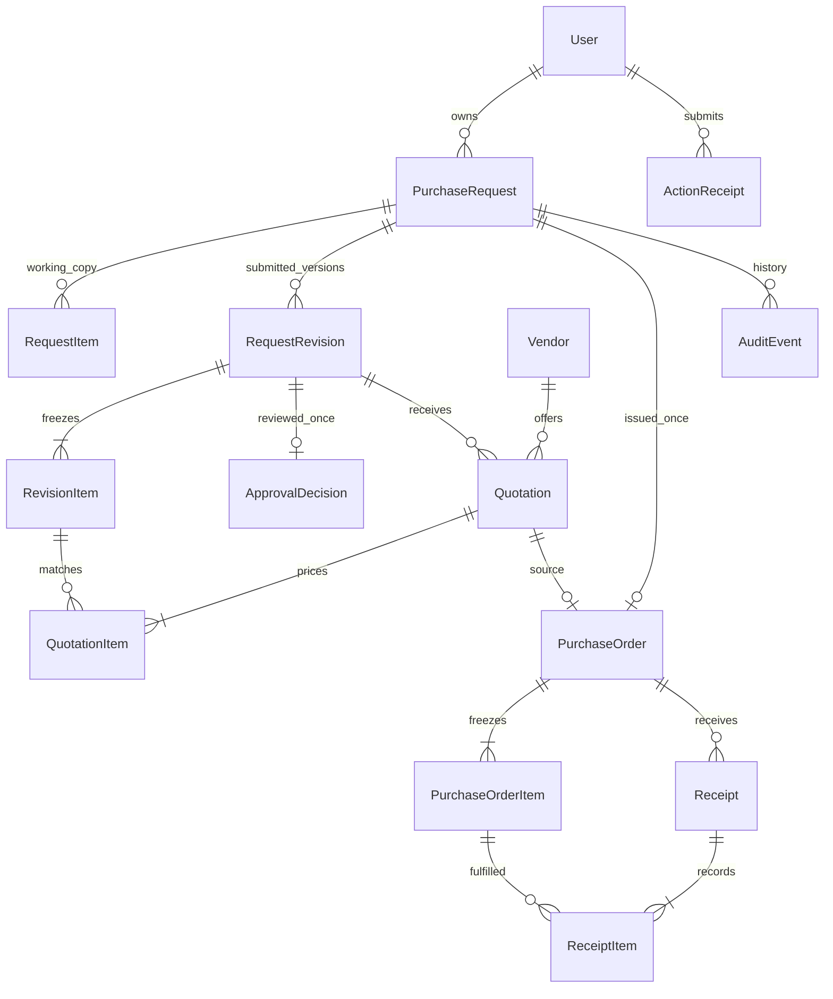

# Model data Procurement

Versi 1.0 | 22 Oktober 2026

Rancangan untuk Django dan SQLite. Model User serta 14 entitas pengadaan sudah mempunyai migrasi dan constraint database. Parser angka dan helper aksi tersedia. Transisi bisnis, kelengkapan lintas relasi, izin objek, dan immutability pada jalur aplikasi masih memerlukan service terkait. [PRD](PRD.md) dan [proses bisnis](BUSINESS_PROCESS.md) tetap menjadi acuan aturan; [arsitektur](ARCHITECTURE.md) menetapkan transaksi dan akses.

## Identitas dan tipe dasar

Model bisnis menggunakan UUID primary key yang dibuat server. User mempertahankan ID bawaan `AbstractUser`. FK bisnis ke pengguna memakai `PROTECT`; akun dinonaktifkan, bukan dihapus. Timestamp memakai timezone-aware UTC dan tampil dalam WIB. Field `version` berupa integer positif mulai 1 dan bertambah sekali untuk setiap aksi sukses yang mengubah aggregate.

`role` dan `status` memakai `TextChoices` serta constraint daftar nilai. UUID tidak menggantikan pemeriksaan izin. String yang wajib diisi ditrim dan ditolak bila kosong. Batas karakter: judul/nama 200, unit 40, nomor/referensi 100, kontak/lokasi 500, alasan/catatan 4.000. Batas ini divalidasi form dan service; constraint panjang database ditambahkan untuk field bisnis karena SQLite tidak menegakkan `varchar(n)` seperti PostgreSQL.

Header working copy boleh belum lengkap saat DRAFT/CHANGES_REQUESTED: judul/alasan/tujuan boleh kosong dan `needed_on` nullable. `kind` tetap wajib. RequestItem yang disimpan harus lengkap dan positif; request boleh belum mempunyai item. Submit memeriksa kelengkapan header, tanggal, dan minimal satu item. Snapshot revisi tidak mempunyai kelonggaran draft ini.

Nomor dokumen berupa `PR-<UUID>`, `PO-<UUID>`, atau `RCV-<UUID>` dengan UUID lengkap yang dibuat server. Nomor unik dan immutable; tidak memakai `MAX(number)+1` atau menjanjikan nomor urut tanpa celah.

## Angka dan pembulatan

Database menyimpan kuantitas sebagai `qty_milli` (1 unit = 1.000) dan nominal sebagai `*_minor` (1 IDR = 100). Keduanya memakai `BigIntegerField` dengan check rentang `0..9223372036854775807`; jumlah pesanan dan harga wajib > 0. Nama kolom harus menunjukkan skalanya. Browser menerima dan menampilkan desimal, bukan bilangan internal.

Parser menerima string angka biasa dengan pemisah desimal titik, kuantitas maksimal tiga desimal, uang maksimal dua desimal. Label memberi contoh format; tampilan read-only memakai format Indonesia. Tolak float dari pemanggil service, eksponen, NaN, Infinity, tanda negatif, nilai di luar rentang, dan presisi berlebih. Nol hanya diizinkan pada accepted/rejected. Tidak membulatkan input yang melanggar presisi secara diam-diam.

Python menghitung dengan `Decimal` dalam `localcontext(prec=64)`, `ROUND_HALF_UP`, lalu mengubah hasil menjadi integer minor unit. Total dokumen adalah jumlah total baris yang sudah dibulatkan. Validasi overflow pada hasil baris dan total sebelum menyimpan; akumulasi menggunakan integer Python, bukan SQL SUM yang dapat melampaui batas integer SQLite. Ini batas penyimpanan teknis, bukan plafon bisnis tambahan.

| Contoh sintetis | Hasil yang harus sama pada form, service, dan tampilan |
| --- | --- |
| Qty `0.333`, harga `0.05` | Total baris `0.02` IDR = 2 minor |
| Dua baris masing-masing qty `0.5`, harga `0.01` | Setiap baris `0.01`; total dokumen `0.02` |
| Dipesan 10, accepted 6, rejected 2 | Remaining 4; kiriman pengganti accepted 4 menyelesaikan PO |

Untuk angka nonnegatif, oracle pengujian total baris adalah `(qty_milli * unit_price_minor + 500) // 1000`. Total baris yang membulat menjadi nol tetap sah bila qty dan harga positif; total dokumen tidak dipaksa positif di luar ketentuan PRD. Simpan angka dalam JSON snapshot/audit sebagai string desimal kanonik agar JavaScript tidak kehilangan presisi integer besar.

## Relasi utama

Diagram menunjukkan hubungan dan kardinalitas bisnis. Kelengkapan minimal satu baris serta kesamaan parent lintas relasi diperiksa service; FK sendiri tidak menjamin aturan tersebut.

## Entitas dan constraint

Nama field di bawah menjadi kontrak implementasi. Field `id`, `created_at`, dan `updated_at` digunakan sesuai kebutuhan entitas; snapshot/audit hanya mempunyai waktu pembuatan. Tidak ada endpoint hapus untuk dokumen yang sudah diajukan.

| Model / file | Field utama | Constraint dan perilaku |
| --- | --- | --- |
| `User` / `accounts/models.py` | AbstractUser, `role`, `version`, `is_active` | Username unik. Role satu nilai yang diizinkan; password melalui `set_password`. Tidak ada bypass aturan bisnis untuk superuser. |
| `PurchaseRequest` / `models/requests.py` | `number`, `requester`, `kind`, `title`, `reason`, `destination`, `needed_on`, `status`, `version`, `current_revision_number`, `selected_quotation` nullable | Nomor unik. Jenis GOODS/SERVICES. Nomor revisi awal 0. Pointer penawaran hanya untuk request/revisi aktif; `PROTECT`. Status awal DRAFT. |
| `RequestItem` / `models/requests.py` | `request`, `position`, `name`, `unit`, `qty_milli`, `estimated_unit_price_minor` | Unik `(request, position)`. Working copy boleh diubah/dihapus hanya saat DRAFT/CHANGES_REQUESTED. Snapshot tidak merujuk FK ke working item yang dapat dihapus. |
| `RequestRevision` / `models/requests.py` | `request`, `number`, `kind`, `title`, `reason`, `destination`, `needed_on`, `estimated_total_minor`, `submitted_by`, `submitted_at` | Unik `(request, number)`, number > 0. Header immutable. Nilai plafon persetujuan berasal dari total revisi ini. |
| `RevisionItem` / `models/requests.py` | `revision`, `position`, `name`, `unit`, `qty_milli`, `estimated_unit_price_minor`, `line_total_minor` | Unik `(revision, position)`. Qty/harga positif, line_total >= 0 sesudah pembulatan; snapshot immutable dan semua FK berikutnya memakai `PROTECT`. |
| `ApprovalDecision` / `models/requests.py` | `revision` one-to-one, `actor`, `requester_at_decision`, `decision`, `reason`, `decided_at` | APPROVE/REQUEST_CHANGES/REJECT; satu keputusan per revisi. Actor berbeda dari requester. Alasan wajib untuk revisi/tolak. Actor bukan pemohon diperiksa service dan check pada dua FK di baris yang sama. |
| `Vendor` / `models/sourcing.py` | `name`, `contact`, `is_active`, `version`, pencipta/waktu | Nama dan kontak wajib; nonaktif alih-alih hapus. Penawaran/PO lama tetap dapat dibaca. |
| `Quotation` / `models/sourcing.py` | `revision`, `vendor`, `reference`, `quoted_on`, `valid_until`, `fulfillment_days`, `total_minor`, `created_by` | Tanggal `quoted_on <= valid_until`, fulfillment_days >= 0. Edit hanya revisi aktif APPROVED sebelum PO. Referensi tidak dianggap unik lintas vendor. |
| `QuotationItem` / `models/sourcing.py` | `quotation`, `revision_item`, `unit_price_minor`, `line_total_minor` | Unik `(quotation, revision_item)`. Seluruh RevisionItem harus dicakup tepat sekali; qty/unit memakai snapshot revision item sehingga tidak dapat diganti browser. Harga > 0. |
| `PurchaseOrder` / `models/orders.py` | `number`, `request` one-to-one, `revision`, `quotation` one-to-one, `vendor`, `vendor_name`, `vendor_contact`, `kind`, `destination`, `total_minor`, `selection_reason`, `single_source_reason`, `status`, `version`, `issued_by`, `issued_at`, `closed_by/at/reason` nullable | Satu PO sepanjang riwayat request, termasuk setelah terminal. Seluruh FK sumber `PROTECT`. Header snapshot immutable; hanya status/version/penutupan dapat berubah melalui service. |
| `PurchaseOrderItem` / `models/orders.py` | `order`, `revision_item`, `position`, `name`, `unit`, `qty_milli`, `unit_price_minor`, `line_total_minor` | Unik `(order, position)` dan `(order, revision_item)`. Snapshot immutable, jumlah/harga positif. |
| `Receipt` / `models/receipts.py` | `number`, `order`, `kind`, `reference`, `notes`, `evidence_type`, `service_started_on/ended_on` nullable, `confirmed_by`, `confirmed_at` | Nomor unik. Barang memakai evidence_type GOODS_DELIVERY; jasa SERVICE_REPORT/SERVICE_ACCEPTANCE. Periode wajib untuk jasa, awal <= akhir <= tanggal konfirmasi WIB; periode barang kosong. Immutable setelah posting. |
| `ReceiptItem` / `models/receipts.py` | `receipt`, `order_item`, `accepted_milli`, `rejected_milli`, `rejection_reason` | Unik `(receipt, order_item)`, accepted/rejected >= 0 dan salah satu > 0. Alasan wajib bila rejected > 0. Service mengabaikan baris dengan dua nol dan menolak receipt yang akhirnya kosong. |
| `AuditEvent` / `models/audit.py` | `request` nullable, `actor`, `actor_name`, `actor_role`, `action`, `target_type`, `target_id`, `reason`, `changes`, `created_at` | Request FK PROTECT untuk kejadian pengadaan; null untuk akun/vendor. `changes` JSON whitelist. Append-only melalui aplikasi, akses mengikuti target/request. Snapshot nama/peran menjaga konteks perubahan akun. |
| `ActionReceipt` / `models/audit.py` | `actor`, `nonce`, `action`, `target_type`, `target_key`, `payload_hash`, `result_type`, `result_id`, `created_at` | Unik `(actor, nonce)`. Scope/hash harus cocok saat replay. Satu baris hanya ditulis setelah aksi berhasil dalam transaksi yang sama. Tidak memiliki endpoint publik untuk daftar. |

`AuditEvent.target_id` dan `ActionReceipt.result_id/target_key` memakai string agar menampung User ID integer maupun UUID dokumen. Resolver hasil hanya menerima jenis model allowlist, bukan import/path/URL dari browser. Metadata penutupan PO wajib untuk CANCELLED/CLOSED_SHORT dan kosong untuk ISSUED/PARTIALLY_RECEIVED/RECEIVED; RECEIVED dibuktikan oleh penerimaan final, bukan tindakan penutupan manual.

`PurchaseRequest.selected_quotation` menyimpan satu kandidat aktif. `selection_reason` dan `single_source_reason` juga disimpan pada PurchaseRequest sebagai field kerja; keduanya disalin ke PO saat terbit. Mengubah kandidat, mengedit penawaran terpilih, meminta revisi, atau membatalkan request menghapus pointer dan kedua alasan; pemilihan kembali memerlukan alasan baru. Audit menyimpan alasan terdahulu.

Foreign key historis menggunakan `PROTECT`, kecuali anak working copy yang mengikuti penghapusan draft item melalui service. Draft request juga dibatalkan, tidak dihapus. Tidak ada cascade yang menghapus revisi, keputusan, penawaran, PO, penerimaan, atau audit. Immutability dijaga oleh jalur aplikasi dan test; perubahan database langsung oleh operator bukan akses pengguna aplikasi dan tidak diproteksi dengan klaim database immutable.

## Revisi dan persetujuan

`current_revision_number` menunjukkan pengajuan terakhir, bukan versi working copy. `version` mendeteksi perubahan aggregate, termasuk edit item, keputusan, penawaran, dan kandidat vendor. Keduanya tidak dipertukarkan.

Submit membuat RequestRevision dan seluruh RevisionItem sekaligus, menaikkan nomor revisi, lalu mengubah status menjadi SUBMITTED. Draft pertama menghasilkan revisi 1. Setelah REQUEST_CHANGES, pemohon mengedit working copy; snapshot revisi sebelumnya tidak berubah. Pengajuan ulang menghasilkan revisi berikutnya, walaupun isinya sama.

Approver memutuskan revisi aktif sekali. Procurement yang mengembalikan APPROVED ke CHANGES_REQUESTED menulis AuditEvent, bukan keputusan approver kedua. Keputusan APPROVE sebelumnya tetap historis. Pemilihan dan penerbitan PO memerlukan request APPROVED, revisi aktif, dan keputusan APPROVE yang cocok. Hanya status APPROVED tidak cukup untuk melewati pemeriksaan ini.

## Status dan sumber jumlah

| Aggregate | Status | Efek yang dijaga |
| --- | --- | --- |
| Request | DRAFT, SUBMITTED, CHANGES_REQUESTED, APPROVED, REJECTED, CANCELLED | Transisi persis seperti BUSINESS_PROCESS bagian 5; REJECTED/CANCELLED terminal. Setelah PO terbit, status request tetap APPROVED. |
| PO | ISSUED, PARTIALLY_RECEIVED, RECEIVED, CANCELLED, CLOSED_SHORT | Transisi persis seperti BUSINESS_PROCESS bagian 6. Tiga status terakhir terminal. |
| Penawaran | Kelayakan dihitung, tanpa status tersimpan tambahan | Revisi cocok, request APPROVED, belum ada PO, vendor aktif, item lengkap, tanggal berlaku, dan plafon sesuai untuk penerbitan. |
| Penerimaan | Hanya catatan final yang berhasil diposting | Input yang belum dikonfirmasi tetap form; tidak menyimpan receipt setengah jadi. |

Accepted/rejected kumulatif berasal dari ReceiptItem yang sudah commit. Remaining dihitung per PurchaseOrderItem sebagai ordered minus accepted; tidak ada kolom saldo kedua. Posting receipt menentukan status PO dari accepted seluruh item. Penolakan saja mempertahankan ISSUED. Penutupan PO tidak mengubah qty atau menciptakan receipt.

Kelayakan penawaran tanggal diperiksa dengan `timezone.localdate()` di dalam transaksi penerbitan. Satu penawaran layak diperbolehkan; alasan sumber tunggal wajib bila hanya satu penawaran yang memenuhi kelengkapan, vendor aktif, tanggal berlaku, dan plafon pada saat pemilihan. Penerbitan mengulang hitungan tersebut; jika kondisi menjadi tunggal dan alasannya belum ada, tolak dan minta procurement memilih kembali. Beberapa penawaran dari vendor yang sama tetap dihitung sebagai satu sumber untuk pemeriksaan ini.

## Invariant lintas tabel dan transaksi

| Invariant | Perlindungan | Bukti yang direncanakan |
| --- | --- | --- |
| PO maksimal satu per request sepanjang riwayat | OneToOne request, transaksi IMMEDIATE, versi request | TC-11: dua penerbit, token sama/berbeda, PO terminal tidak dapat diganti |
| Isi penawaran sama dengan revisi | FK RevisionItem, unique per item, pemeriksaan himpunan item di service | TC-08: item hilang, berulang, asing, atau dari revisi lain ditolak |
| Nilai PO <= plafon revisi disetujui | Total dihitung server; recheck keputusan dan revisi dalam transaksi | TC-10/TC-11: ubah plafon/total/ID dari form tidak lolos |
| Accepted kumulatif <= qty dipesan | Hitung ulang semua receipt setelah memperoleh write lock, validasi seluruh baris, atomic commit | TC-13: dua koneksi menerima sisa yang sama; hanya satu diterima |
| Pembatalan request bersamaan PO terbit | Kedua service membaca request di dalam IMMEDIATE dan menaikkan versi | TC-11/TC-15: hanya satu hasil valid, tanpa CANCELLED dengan PO aktif |
| Penutupan PO bersamaan penerimaan | Versi PO + transaksi IMMEDIATE | TC-13/TC-16: aksi kedua membaca status/versi terbaru dan konflik |
| Vendor nonaktif tidak dipakai menerbitkan PO | Edit vendor dan penerbitan memakai protokol transaksi yang sama | TC-07/TC-11: deactivation lebih dulu menolak issue; issue lebih dulu menyimpan snapshot historis |
| User tidak menyetujui/mengakhiri PO miliknya | Owner dibanding actor dari database, termasuk setelah perubahan peran | TC-02/TC-06/TC-16 |
| Tidak ada dokumen bisnis tanpa audit/hasil aksi | Semua row ditulis dalam atomic yang sama | TC-13: fault injection pada audit menyebabkan rollback seluruh perubahan |
| Data lama tidak ditimpa | expected_version pada request, PO, akun, vendor | TC-06/TC-18: dua tab memakai versi lama |

Konfigurasi SQLite dan urutan replay mengikuti ARCHITECTURE. `ActionReceipt` tidak menyimpan payload mentah. Pembuatan akun yang membawa password awal serta reset password tidak memakai payload hash dari password: action hanya berlaku sekali, replay token sama menghasilkan 409, dan admin memuat ulang form untuk tindakan baru. Perubahan akun selain password memakai hash metadata whitelist. Hanya hasher Django menyimpan turunan password di User.

Untuk form normal yang gagal validasi, jangan menaikkan version atau mencatat sukses. Service memeriksa ulang field dan relasi meskipun view telah menjalankan `form.is_valid()`. Constraint database melindungi satu baris/keunikan; validasi himpunan dan penjumlahan lintas baris tetap tanggung jawab service.

## Query, indeks, dan migrasi

Indeks awal: PurchaseRequest `(requester, created_at)`, `(status, created_at)`, `(kind, created_at)`; Quotation `(revision, vendor)`; PurchaseOrder `(status, issued_at)`; AuditEvent `(request, created_at)`. FK dan unique constraint memberi indeks relasi. Pencarian nomor/judul menggunakan ORM dan paginasi; tidak ada full-text engine pada versi pertama.

Custom User harus tersedia sebelum migrasi model yang merujuk AUTH_USER_MODEL. Urutan migrasi: User; request/revisi/keputusan; vendor/penawaran; pointer kandidat pada request; PO/item; receipt/item; audit/action receipt. Django dapat memecah circular dependency pointer kandidat dalam migrasi terpisah. Simpan semua file migrasi di Git dan uji dari database kosong.

Command `seed_demo` memakai akun lima peran, vendor, serta alur barang/jasa sintetis. Command idempotent melalui identitas seed yang stabil; tidak mereset database, password akun existing, atau transaksi pengguna. Password awal berasal dari `DEMO_PASSWORD` pada environment, tidak tercetak pada log. Data demo dan hasil uji tidak disertakan sebagai database biner dalam repo.

## Status verifikasi

Migrasi awal berhasil pada database kosong, dapat dibatalkan dan diterapkan ulang pada database terisolasi. Constraint, parser angka, scope/umur token, replay, versi, serta rollback audit/hasil aksi sudah diuji. Helper aksi wajib dipanggil setelah service memeriksa akun dan izin terkini; helper tidak menggantikan policy. Aksi `account.create` dan `account.password` memakai nonce sekali tanpa hash payload password; perilaku bawaan ini sudah mempunyai regresi otomatis. Service `save_user` dan `reset_password` membaca ulang admin aktif sebelum replay, memeriksa versi, serta menyimpan akun, audit dan hasil aksi secara atomik. Metadata edit memakai `account.edit`; guard admin terakhir dan batas versi juga diuji.

Implementasi schema belum menyatakan FR-01 sampai FR-13 selesai dan tidak mengubah PRD, BPMN, atau status paket WBS. Implementasi harus membuktikan snapshot, izin, presisi, replay, rollback, dan concurrency dengan database SQLite berbasis file. TestCase dengan satu koneksi atau SQLite in-memory saja tidak cukup untuk menyatakan kasus dua penulis sudah aman.
